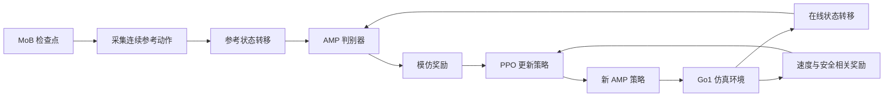

# 从 MoB 动作到 Go1 AMP 策略：完整教程

本教程以本仓库当前实现为准：用已训练的 MoB 策略生成 Go1 小跑参考动作，再训练
一个新的 AMP 策略。目标是平地上按 `0.2–0.8 m/s` 的前进命令小跑。当前实验
**不包含跌倒恢复**，也没有转弯、侧移或其他步态的参考数据。当前配置已训练出
稳定的前进 Trot，四档速度的定量评估见
[`amp_code_tutorial.md`](amp_code_tutorial.md#83-本次实测结果)。

> 想深入理解每一步的原理和代码实现，请看
> [`amp_code_tutorial.md`](amp_code_tutorial.md)（逐文件、逐函数讲解）。

## 1. 先理解 AMP 在做什么

普通速度跟踪强化学习给策略一个速度命令，再用人工设计的奖励鼓励它跟踪速度。
单靠这个目标，机器人可能找到速度正确但动作难看的走法。AMP 多引入一个从
参考动作学习的判别器：它观察连续两帧机器人状态，区分“来自 MoB 参考动作”
与“来自新策略”。新策略在跟踪速度的同时，从判别器得到动作风格奖励。



这里的 MoB 检查点只负责**生成参考动作**。AMP 策略从随机参数开始训练，
不需要在每个时刻追踪某一段指定的 MoB 轨迹，也不要求参考轨迹与在线策略
对齐到相同的相位。这与逐帧轨迹跟踪的训练方式不同。原始 AMP 论文也采用
“任务奖励 + 动作风格奖励”的思路，并用参考动作状态转移训练判别器。
参见 [AMP 原论文](https://xbpeng.github.io/projects/AMP/AMP_2021.pdf)。

## 2. 准备仓库和 MoB 检查点

在仓库根目录执行以下命令。若 `.venv` 尚未安装，先按
[README 的安装步骤](../README.md)执行 `uv sync`。

```bash
uv run go1-list-tasks
ls logs/rsl_rl/go1_mob/2026-10-27_15-04-14/model_5050.pt
```

任务列表中应有 `Go1-Velocity-MoB` 和 `Go1-Velocity-AMP`。第二条命令里的
检查点是本次采集使用的实例；在其他机器上复现时，换成自己已训练并播放
确认过的 MoB 检查点。AMP 的参考动作和训练环境必须使用同一款 Go1、相同的
关节顺序以及一致的仿真步长。

## 3. 用 MoB 策略采集参考动作

```bash
uv run --no-sync python -m go1_tasks.collect_mob_amp \
  --checkpoint logs/rsl_rl/go1_mob/2026-10-27_15-04-14/model_5050.pt \
  --gait Trot \
  --speeds 0.2 0.4 0.6 0.8 \
  --clips-per-speed 3 \
  --seconds 5 \
  --warmup-seconds 1
```

脚本对每个速度采集 3 段、每段 5 秒的连续仿真状态。环境控制频率为 50 Hz，
所以每段保存 251 帧，可提供 250 个相邻帧样本。采集前先预热至少 30 个控制
步，让 MoB 策略的 30 帧历史观测填满；预热或录制时跌倒的片段会被丢弃并
重试。文件默认写入 `logs/amp/mob_reference/trot/vx_*/clip_*.npz`。

如果采集中断，原命令末尾加 `--resume`：脚本会检查已有片段并跳过，不覆盖
已有数据。如果没有可用 GPU，可加 `--device cpu`。采集文件保存在被 Git 忽略
的 `logs/` 目录，复制项目源码时需单独保留这些数据。

**为什么保存仿真状态，而不是 MoB 的 1710 维策略观测？** 策略观测含历史、
命令和动作等字段，部分字段还可能带观测噪声。AMP 判别器需要从参考动作和
新策略的真实状态构造完全相同的特征。保存机身位姿、速度、关节与足端状态，
以后可以统一计算特征，也方便检查坐标系和关节顺序。完整文件字段见
[采集与数据格式说明](amp_mob_collection.md)。

采集完成后，先按[参考动作可视化步骤](amp_mob_collection.md#查看参考动作)
生成 GIF，检查对角足是否交替抬起；只检查文件数量和形状无法证明步态正确。

## 4. 检查参考数据

```bash
uv run --no-sync python -c 'from go1_tasks.amp_data import AmpMotionDataset; d=AmpMotionDataset("logs/amp/mob_reference/trot", fps=50.0); print("片段", d.num_clips, "转移", len(d), "输入形状", tuple(d.sample(256).shape))'
```

对本次已有数据，预期输出是 **12 段、3000 个转移、`(256, 92)`**。四组速度
对应的实测机身前向速度平均值约为 `0.189、0.388、0.596、0.799 m/s`。
读取器会拒绝缺字段、形状错误、非有限数值、非单位四元数、关节顺序不一致、
足端顺序不一致或频率不一致的片段。

每个 `.npz` 先在文件内部配对第 `t` 帧和第 `t+1` 帧，再把各文件的样本
拼接。因此不会把一段结束后的状态与另一段开头的状态误当作连续运动。

## 5. 看清判别器的 92 维输入

参考动作和在线策略都通过 `go1_tasks.amp_data.amp_frame` 构造单帧特征：

| 顺序 | 特征 | 维度 | 坐标系 |
| --- | --- | ---: | --- |
| 1 | 机身高度 `z` | 1 | 世界坐标系，当前平地地面为 `z=0` |
| 2 | 重力方向 | 3 | 机身坐标系 |
| 3 | 机身线速度 | 3 | 机身坐标系 |
| 4 | 机身角速度 | 3 | 机身坐标系 |
| 5 | 关节位置 | 12 | 采集文件的 `joint_names` 顺序 |
| 6 | 关节速度 | 12 | 同上 |
| 7 | 四只脚相对机身的位置 | 12 | 机身坐标系，`FR、FL、RR、RL` |
| | **单帧合计** | **46** | |

将 `[特征(t), 特征(t+1)]` 拼接，就得到 92 维判别器输入。绝对的世界
`x/y`、绝对朝向和速度命令不进入判别器；任务命令由 PPO 策略及任务奖励处理。
机身线速度这 3 维在仿真中可以直接从机器人状态获取，也已保存在参考文件里。
四元数按 `wxyz` 读取，用它将世界坐标的重力方向与足端相对位置转到机身
坐标系。原论文同样强调状态转移特征、速度特征和梯度惩罚对训练效果的作用，
但本文的具体特征表是本仓库的 Go1 实现选择。

新 AMP 策略的输入与判别器输入是两回事。**Actor 输入是单帧 45 维**：
机身角速度 3、投影重力方向 3、关节位置偏移 12、关节速度 12、上一动作 12、
速度命令 3。Actor 输出 12 个关节目标偏移。**Critic 输入 72 维**，其中可
包含仿真中可得的机身线速度和足端信息；它只参与训练。判别器额外读取
92 维状态对，只在训练时提供奖励。MoB 原策略的 1710 维历史观测只用于
生成参考数据，AMP 策略不会使用它，也没有 MoB 行为命令或步态时钟。
若把机身线速度 3 维也加入 actor，输入就会是 48 维；本实现选择 45 维，
因为线速度在真实机器人上通常需要状态估计，训练时则可把仿真值交给 critic
和判别器使用。**45、48 和 46 分别属于不同输入接口**：45 是当前 actor，
48 是可选的 actor 设计，46 是单帧判别器特征。

## 6. 判别器与 PPO 如何一起训练

训练环境是 `Go1-Velocity-AMP`：只抽样 `0.2–0.8 m/s` 的前进命令，
侧向和偏航命令为 0。Trot 风格由参考动作提供，没有额外的步态命令。
环境奖励包含速度跟踪、
直立、关节限位、动作变化率与足端打滑。跌倒触发普通终止和重置。

记单个 92 维状态对为 `x`，判别器输出 logit `D(x)`。本仓库沿用 AMP 原论文的
最小二乘判别目标：参考动作的目标为 `+1`，策略生成的动作为 `-1`，损失为两者
MSE 的均值；并在参考样本上对 `D` 相对输入的梯度平方加惩罚，以限制判别边界。
判别器输入的每一维先用运行均值/方差归一化（统计量由参考数据初始化，训练中
用参考与策略样本共同更新），避免关节速度等大尺度特征主导判别。策略得到的
AMP 风格奖励是：

```text
r_AMP(x) = 2.0 × 0.02 × clamp(1 − 0.25 × (D(x) − 1)², min=0)
r_total  = r_task + r_AMP(x)                  （仅未终止的相邻状态对）
```

其中 `2.0` 是默认 `amp_reward_weight`，`0.02` 是环境控制步长。任务奖励
本身也按控制步长缩放，因此 AMP 奖励要采用同一单位。这个奖励有界于
`[0, 2.0 × 0.02]`：`D=1` 时最大，`D≤−1` 时为 0。与早先的交叉熵 +
`softplus(D)` 相比，有限目标不会让判别器把策略 logit 推到 −∞，因此不会出现
风格奖励梯度完全消失、策略再也学不会模仿的塌陷。判别器默认是
`92 → 256 → 128 → 1` 的 ReLU 网络；学习率 `1e-4`、每轮 8 次判别器更新、
批量 1024、梯度惩罚权重 10，历史策略转移缓存容量 100000。训练顺序是：

1. 当前策略采集轨迹；对未终止的相邻状态对计算 AMP 奖励。
2. PPO 用任务奖励与 AMP 奖励之和更新 actor、critic。
3. 把本轮有效的策略状态对放入缓存，从缓存与参考数据分别抽样，更新判别器。
4. 重复。重置边界不进入判别器训练，也不获得 AMP 奖励。

本实现沿用 AMP 的对抗动作先验思路，判别器损失和风格奖励采用论文的形式；
特征表、网络宽度和更新频率是本仓库的 Go1 选择。论文的训练流程见
[AMP 原论文](https://xbpeng.github.io/projects/AMP/AMP_2021.pdf)，
PPO 的原理见 [PPO 论文](https://arxiv.org/abs/1707.06347)。

## 7. 开始训练并查看结果

推荐先用本地 TensorBoard 日志运行，避免依赖外部账号：

```bash
uv run go1-train Go1-Velocity-AMP \
  --env.scene.num-envs 1024 \
  --agent.logger tensorboard \
  --agent.upload-model False
```

默认训练 10000 轮，每轮每个环境采集 24 步；默认每 50 轮保存一次 checkpoint。
日志与权重位于 `logs/rsl_rl/go1_amp/<日期时间>/`。训练启动时应打印类似
`[AMP] 12 clips, 3000 transitions, 50 Hz`。若参考数据放在别处，添加
`--agent.algorithm.reference-path /你的/参考目录`。

资源有限时，可先执行短检查：

```bash
uv run go1-train Go1-Velocity-AMP \
  --env.scene.num-envs 16 \
  --agent.max-iterations 2 \
  --agent.logger tensorboard \
  --agent.upload-model False
```

短检查只验证程序能运行、能写 checkpoint，不能判断最终步态质量。正式训练
时观察 `Train/mean_reward`、`Train/mean_episode_length`、
`Loss/amp_discriminator`、`Loss/amp_style_reward_per_step`、
`Loss/amp_expert_logit`、`Loss/amp_policy_logit` 和各项任务奖励。
如果风格奖励持续接近 0，说明策略没有得到有效的步态引导，应停止这轮训练
排查判别器。单看判别器损失无法判定动作是否好；
还需要看机器人是否稳定、实际速度是否接近命令、足端是否持续打滑。

如果需要从已保存的 AMP checkpoint 继续训练，可指定运行目录名和文件名：

```bash
uv run go1-train Go1-Velocity-AMP \
  --agent.resume True \
  --agent.load-run YOUR_RUN \
  --agent.load-checkpoint model_1000.pt \
  --agent.max-iterations 1000 \
  --agent.logger tensorboard \
  --agent.upload-model False
```

这里的 `max-iterations 1000` 表示本次**再运行 1000 轮**。AMP checkpoint
保存 actor、critic、判别器及各自优化器状态，还会保存 AMP 特征归一化的
均值/方差；历史策略转移缓存不保存，恢复后会重新积累。继续训练时仍需保留
参考动作文件。判别器结构已从带谱归一化的 ELU 网络改为 ReLU + 最小二乘目标，
因此旧版 checkpoint（如 `model_9400.pt`）只能用于加载 actor 播放，不能按上述
命令完整恢复训练；验证新配置时应启动一个新的训练运行。

## 8. 播放和验收

把 `YOUR_RUN` 和 checkpoint 文件名换成实际值：

```bash
uv run go1-play Go1-Velocity-AMP \
  --checkpoint-file logs/rsl_rl/go1_amp/YOUR_RUN/model_1000.pt \
  --viewer viser
```

播放时只加载 actor 权重，不读取参考动作文件；参考数据只在继续 AMP 训练时
才需要保留。若训练时使用自定义参考路径，续训时仍需传入相同的
`--agent.algorithm.reference-path`。
在 Viser 的 `Twist` 控件中勾选 `Enable`，将 `lin_vel_x` 依次设为
`0.2、0.4、0.6、0.8`，保持 `lin_vel_y` 和 `ang_vel_z` 为 0。
这样可分别观察四个参考速度附近的动作。

还可以用脚高相关性做一项定量检查：

```bash
uv run --no-sync python -m go1_tasks.eval_amp \
  logs/rsl_rl/go1_amp/YOUR_RUN/model_1000.pt --vx 0.6 --seconds 5
```

脚的顺序是 `FR、FL、RR、RL`。Trot 应表现为两组对角足 `FR–RL`、
`FL–RR` 同相抬起，相邻足交替抬起；比较输出中的对角足与相邻足高度相关性，
同时核对前向速度、跌倒情况和四足抬脚幅度。单个相关系数不能代替动画验收。

当前参考片段只采集了直行 Trot，速度命令都是 `[vx, 0, 0]`。因此训练也将
横向速度和偏航角速度命令固定为 0：这是**命令范围**，不是机器人实际速度
永远为 0，也不是策略输入少了两个维度。Actor 仍接收完整的 3 维命令；
如果希望侧移或转弯时也保持参考步态，需要先采集相应动作，再扩大命令范围。

2026-10-27 的 `model_9400.pt` 经检查尚未学到参考 Trot：在 0.6 m/s 命令
下，实际前进速度约 0.596 m/s，但四足抬脚高度缺少参考中的对角同步。
该 checkpoint 的判别器对参考片段给出约 `+16.64` 的输出，对策略轨迹给出
平均约 `-816`；在当时的 `softplus(D)` 公式下，`softplus(-816)` 在 float32
中直接下溢为 0，梯度也随之为 0，策略获得的 AMP 风格奖励和风格梯度都消失。
这就是二分类交叉熵 + `softplus` 的典型塌陷：BCE 的最优解是 logit 趋于
±∞，一旦判别器过快变得自信，策略就再也无法恢复。

针对这个问题，当前实现改用 AMP 原论文的最小二乘目标（目标 `±1`）、有界风格
奖励、输入特征归一化，并去掉了与梯度惩罚重复的谱归一化；判别器每轮更新的
批次数也恢复到 8（批量 1024），不再只做一次小批量更新。这些改动解决了“奖励
梯度消失”的机制问题，但**不保证一定学出 Trot**。仍需用新运行完成训练，再
运行上面的 `go1_tasks.eval_amp` 并查看动画。

建议至少检查：

- 在 `0.2、0.4、0.6、0.8 m/s` 命令附近能否稳定前进，实际速度是否
  长时间接近命令。
- 步态是否持续呈现 Trot；机身是否剧烈起伏或过度倾斜；脚是否频繁滑动。
- 多次重置后是否能重新开始正常小跑；跌倒后的起身不属于本阶段验收范围。
- 对比不同训练轮次的 checkpoint，选择稳定且动作自然的版本，而不是只看
  最后一轮或某个单独的损失值。

## 9. 常见问题与当前边界

| 现象 | 优先检查 |
| --- | --- |
| 提示找不到 `.npz` | 确认从仓库根目录运行，或设置 `--agent.algorithm.reference-path`。 |
| 提示关节、足端顺序或频率不符 | 不要混用不同机器人、不同仿真步长或不同来源的片段；重新采集匹配数据。 |
| 策略能前进但动作不自然 | 看参考片段本身是否稳定；同时检查 AMP 奖励权重和判别器损失的变化，再播放中间 checkpoint。 |
| 中间速度表现差 | 当前参考数据只有 `0.2、0.4、0.6、0.8 m/s` 四档，而训练命令在 `0.2–0.8 m/s` 连续采样；优先补采中间速度，或把训练命令改为离散四档后重新训练。 |
| 训练早期频繁跌倒 | 检查速度范围是否仍为 `0.2–0.8 m/s`、参考片段是否稳定，以及任务奖励与 AMP 奖励的尺度。 |
| 想训练转弯、侧移、其他步态或起身 | 先补采这些动作的参考数据，再调整命令范围、环境与特征；当前 12 段前进小跑数据不覆盖这些行为。 |

最后，完整训练完成后应报告实际速度误差、跌倒率和动作视频，再决定是否需要
调参或增加参考数据。当前的 4 项自动测试只证明采集数据读取、特征维度、
短训练更新和 checkpoint 恢复这条链路能够工作，不代表策略已经收敛。
仓库目前尚无 AMP 专用的批量定量评估脚本；Viser 播放适合先做动作检查，
要正式比较不同 checkpoint，还应补上固定命令、固定种子和时长的自动评估。
